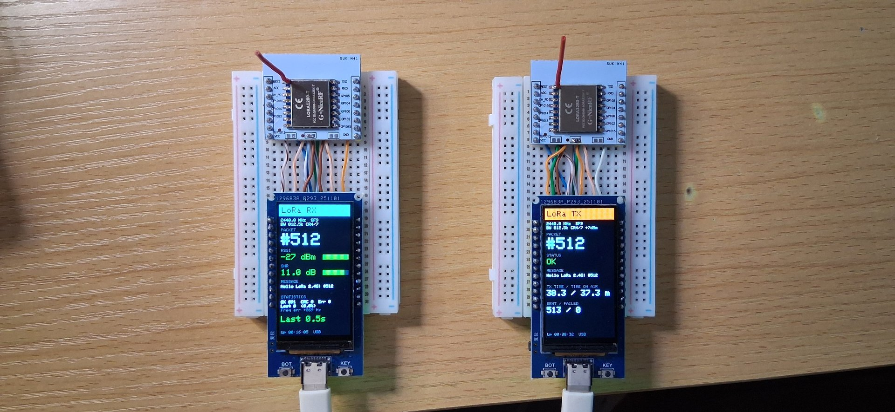

# LORA1280-T + ESP32-S3 1.9" LCD

2.4 GHz LoRa point-to-point link using the NiceRF **LORA1280-T** (Semtech SX1280 with TCXO)
and an **ESP32-S3 board with a 1.9" ST7789 display and a Li-ion battery charger**.

The repository has two firmware versions:

- **`esp-idf/`**: ESP-IDF v5.5 project (main version). One firmware for every board; the role
  (TX / RX) is chosen on the device and saved in flash.
- **`arduino/`**: the original Arduino sketches (TX, blocking RX, interrupt RX).

Both use [RadioLib](https://github.com/jgromes/RadioLib) and show live status on the display.



| TX screen | RX screen |
|---|---|
| packet number, status, message, TX time vs. time on air, sent / failed, uptime, battery | packet number, RSSI and SNR bars, message, OK / CRC / lost (%), frequency error, time since last packet, uptime, battery |

## Hardware

| Part | Notes |
|---|---|
| ESP32-S3 board, 1.9" ST7789 170x320 IPS | 16 MB flash, 8 MB PSRAM, native USB, MX1.25 battery connector, TP4054 charger (500 mA), KEY button on GPIO14 |
| NiceRF LORA1280-T | SX1280, 0.5 ppm TCXO (enabled with the TCXOEN pin), up to 12.5 dBm, supports ranging |
| ESP-12 (ESP8266) breakout board | Used as a 2.0 mm to 2.54 mm adapter for the module (see notes below) |
| 2.4 GHz antenna | A 31 mm wire (quarter wave) works for bench tests |

### Wiring

| ESP32-S3 | LORA1280-T | | ESP32-S3 | ST7789 (on board) |
|---|---|---|---|---|
| GPIO10 | NSS | | GPIO6 | CS |
| GPIO11 | SCK | | GPIO7 | DC |
| GPIO12 | MOSI | | GPIO5 | RST |
| GPIO13 | MISO | | GPIO8 | SCLK |
| GPIO18 | NRESET | | GPIO9 | MOSI |
| GPIO21 | BUSY | | GPIO38 | Backlight |
| GPIO16 | DIO1 | | | |
| GPIO17 | TCXOEN | | | |
| 3.3V / GND | VCC / GND | | | |

Other board pins used: GPIO15 = `PWR_EN` (on battery power it switches the LCD supply and the
battery divider), GPIO4 = battery voltage (100k/100k divider), GPIO14 = KEY.

The display uses SPI2 (FSPI) and the radio uses SPI3 (HSPI), so they never share a bus.

## Radio settings

| Setting | Default | Notes |
|---|---|---|
| Frequency | 2440.0 MHz | Keep within 2402 to 2482 MHz so the whole signal stays inside the 2.4 GHz ISM band |
| Bandwidth | 812.5 kHz | 1625 kHz also offered |
| Spreading factor | 9 | |
| Coding rate | 4/7 | |
| TX power | 7 dBm | See the regulatory note below |
| Sync word | 0x12 (RadioLib default, "private") | There is no official LoRaWAN for 2.4 GHz |

## ESP-IDF version (`esp-idf/`)

### Build and flash

Requires ESP-IDF v5.5 (tested with v5.5.5). RadioLib 7.8.1 is downloaded automatically from the
[ESP Component Registry](https://components.espressif.com/components/jgromes/radiolib).

```bash
. $IDF_PATH/export.sh
cd esp-idf
idf.py build
idf.py -p /dev/ttyACM0 flash monitor
```

Settings are in `idf.py menuconfig` → **LoRa SX1280 settings** (frequency, bandwidth, SF, CR,
TX power, TX interval, default role).

### Choosing the role

The same firmware runs on every board. The role is stored in NVS (flash).

- On the first boot, or when **KEY is held while the board resets or powers up**, the role menu
  appears.
- **Short press**: next role. **Hold 1 s**: select and save ("Saved" is shown).
- After that, the board starts directly in the saved role.

### Structure

```
esp-idf/
  main/                    role menu (main.cpp), role_tx.cpp, role_rx.cpp, Kconfig.projbuild
  components/board/        PWR_EN, backlight PWM, KEY, battery ADC
  components/lcd_ui/       ST7789 via esp_lcd + 6x8 text renderer and small UI helpers
  components/lora_radio/   RadioLib on SPI3; DIO1 interrupt -> FreeRTOS semaphore
```

- **TX** uses `startTransmit()` and sleeps on a semaphore until the DIO1 "TX done" interrupt,
  then `finishTransmit()`. Packets are sent on a fixed 1 s period (`vTaskDelayUntil`).
- **RX** uses continuous reception (`startReceive()`). On each packet it reads the data and
  status, restarts reception immediately, and only then prints and draws, so there is no gap
  in which a packet can be missed.

## Arduino version (`arduino/`)

| Sketch | Description |
|---|---|
| `LORA1280T_TX` | Sends `Hello LoRa 2.4G! #n` every second |
| `LORA1280T_RX` | Blocking receive (`radio.receive()`); see the known issue below |
| `LORA1280T_RX_Interrupt` | Interrupt-driven continuous receive (recommended) |

Requirements: ESP32 Arduino core 3.3.x, RadioLib 7.8.1, GFX Library for Arduino 1.6.x.
Enable **USB CDC On Boot**. With arduino-cli:

```bash
arduino-cli compile -u -p /dev/ttyACM0 --fqbn esp32:esp32:esp32s3:CDCOnBoot=cdc arduino/LORA1280T_TX
```

`lora_ui.h` and `rx_screen.h` are copied into each sketch folder (Arduino sketches cannot share
files). Keep the copies identical when you change them.

## Lessons learned

These cost real debugging time and look like RF problems, so check them first.

1. **RadioLib 7.8.1 `SX128x::receive()` with no timeout returns `RX_TIMEOUT` immediately.**
   The software timeout is compared with the `timeout` argument (0) instead of the computed
   internal value. Always pass a timeout, e.g. `radio.receive(msg, 0, 1000000)`. The SX1280
   hardware limit is about 1.02 s (0xFFFF x 15.625 us).
2. **Blocking receive has a short blind gap after each timeout.** With a 1 s RX window and a
   transmitter that also sends about once per second, the next packet can land in that gap
   every time, and every other packet is lost. Use continuous reception (interrupt) for
   packets that can arrive at any time. Blocking receive is fine for short, expected replies
   (ACKs, ranging).
3. **Arduino: USB CDC `Serial.print` blocks when no serial monitor is open** (up to 100 ms per
   write on ESP32-S3). The TX loop slowed down to one packet every ~3 s, which looked like
   packet loss on the receiver. Fix: `Serial.setTxTimeoutMs(0)`. The ESP-IDF console does
   not have this problem.
4. **Arduino_GFX also uses FSPI on ESP32-S3.** Give the radio its own bus: `SPIClass loraSPI(HSPI)`.
5. **"TX success" does not prove anything was transmitted.** A floating DIO1 line (bad solder
   joint on the adapter board) made RadioLib report TX done instantly and abort the
   transmission. Check that DIO1 is driven: it must read LOW with both pull-up and pull-down.
6. **ESP-12 adapter boards:** if you use the 0 ohm option (no LDO), make sure the LDO pads are
   not bridged by solder.

## Battery

The board has no power switch: with a battery connected, the ESP32-S3 is always powered
(linear LDO, ME6211). USB and battery switch over automatically without a reset. The
battery voltage (GPIO4) is shown on the status line; with USB plugged in it reads the USB rail
and shows `USB`. Rough current with the display on and RX listening is 80 to 120 mA. Lowering
the backlight, the CPU clock (80 MHz) and using light sleep between packets should cut this a lot.

## Regulatory note (Korea)

LoRa is chirp spread spectrum (CSS). Under the Korean technical standard for radio equipment
that can be used without a license (MSIT notice, Article 7(7), data communication devices),
2400 to 2483.5 MHz CSS devices with an occupied bandwidth of 0.5 to 26 MHz are limited to an
average power density of **10 mW/MHz** (antenna gain up to 6 dBi), with out-of-band emissions
of -30 dBm or less (100 kHz RBW). In practice:

- Keep the center frequency between 2402 and 2482 MHz.
- With BW 812.5 kHz, keep the output at 10 dBm or less (7 dBm gives some margin).
- Do not use bandwidths below 812.5 kHz (occupied bandwidth would be under 0.5 MHz).

This was checked against the 2019 version of the notice (No. 2019-105). It is not legal
advice; check the current text and the rules in your country. Selling a product needs
certification (KC in Korea).

## Roadmap

- [x] Arduino TX / RX with display
- [x] ESP-IDF port: one firmware, role menu, interrupt-driven TX and RX, battery voltage
- [ ] SX1280 ranging (master / slave roles), calibration
- [ ] Power saving (backlight, CPU clock, light sleep)
- [ ] Perfboard build with battery

## References

- [Semtech SX1280](https://www.semtech.com/products/wireless-rf/lora-24ghz/sx1280) (datasheet,
  AN1200.29 ranging application note)
- [NiceRF](https://www.nicerf.com/) LoRa1280 module datasheet
- [RadioLib](https://github.com/jgromes/RadioLib)
- [GFX Library for Arduino](https://github.com/moononournation/Arduino_GFX)

## License

MIT, see [LICENSE](LICENSE). The 5x7 font in `esp-idf/components/lcd_ui/font5x7.h` is from
Adafruit_GFX and is under the BSD license; see [THIRD_PARTY_NOTICES.md](THIRD_PARTY_NOTICES.md).
